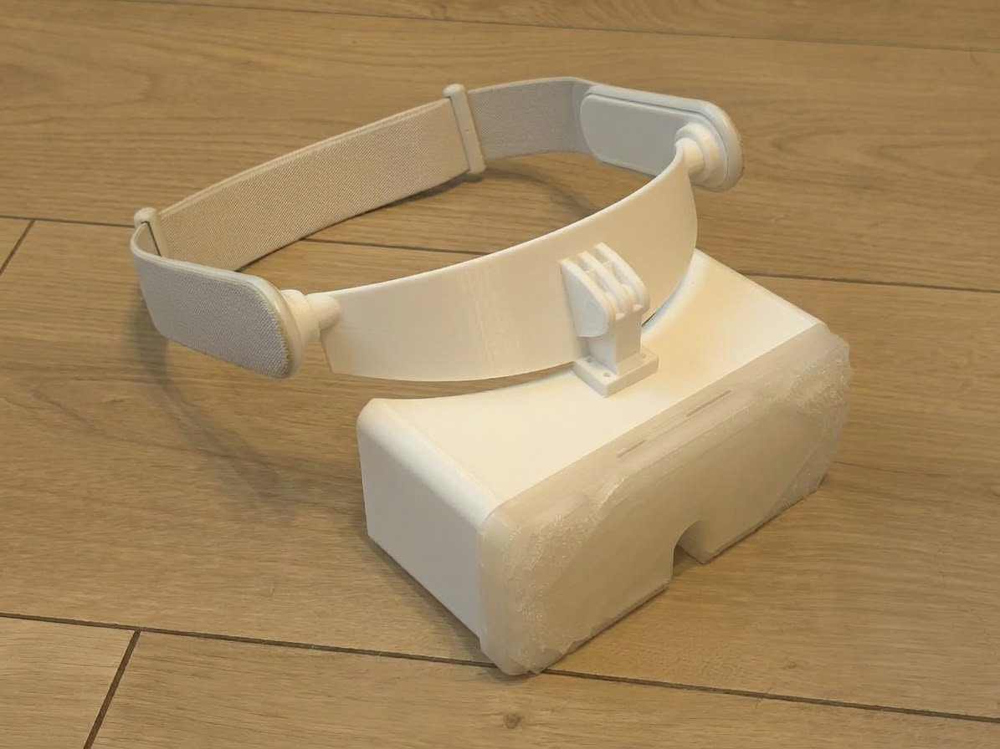

# Halo One

Halo One is a very compact and lightweight DIY PCVR headset.
It can work with SteamVR, so you can play games like Half Life Alyx.
Unlike other diy VR projects, i created launcher that installs every needed thing on your pc,
so you dont need to worry about complicated software setup. Headset uses RPI Pico 2 microcontroller,
and LSM6DS3 IMU board, it should provide fine 3DoF tracking. I am planning to make this headset 6DoF using 
PS3 Move cameras, but for now its 3DoF. Headset is pretty lightweight, around 150g without head strap.
Halo One has halo strap, so it will be comfortable, i think. 

### Key features:
- Dual 1600x1600 90hz lcd panels, 1078 PPI
- Easy and straight forward software configuration
- Stable 3DoF tracking using LSM6DS3 IMU board
- Comfortable halo strap
- ~150g without head strap, ~225g with head strap.

If you have any questions, suggestions etc, feel free to ask.

Only assembled casing, for illustration purposes.

> [!NOTE]
> ### Software Configuration
> To use Halo One, you need to install the latest Halo Launcher release and open it. The launcher will automatically install and configure everything on your PC.
> Currently the launcher works best on arch based linux distros(but it should work on Windows and non-arch based distros). 
> 
> To configure the microcontroller board:
> 1. Download the `Pico2_Firmware` folder from this repository.
> 2. Install the latest version of **Arduino IDE**.
> 3. Open Arduino IDE, go to **Boards Manager**, and install the **"Raspberry Pi Pico/RP2040/RP2350"** board package by Earle F. Philhower, III.
> 4. Go to **Library Manager**, search for **FastIMU** by LiquidCGS, and install it.
> 5. **Important (Entering Bootloader Mode):** Press and hold the physical **BOOTSEL** button on your Raspberry Pi Pico 2, and while holding it, plug the Pico 2 into your computer via USB. Then release the button.
> 6. Open the `Pico2_Firmware.ino` file in Arduino IDE (**File >> Open** or `CTRL+O`).
> 7. Select **Raspberry Pi Pico 2** as your target board in the top-left menu (or via Tools -> Board).
> 8. Click the **Upload** button. Everything should compile and flash successfully!

> [!TIP]
> Currently, this headset setup has a relatively narrow FOV. I am planning to design updated optics for a future revision. If you prefer a wide FOV, please stay tuned for future updates!

>[!WARNING]
>This project is at early development state,
>expect bugs!

## Bill Of Materials

| Part                                 | Quantity | Price per 1 item  |
| ------------------------------------ | -------- | ----------------- |
| RPI Pico 2                           |    1     | ~$8               |
| LSM6DS3 board                        |    1     | ~$2.50            |
| Fresnel lenses d40mm fl28mm          |    2     | ~$1.30            |             
| 1600x1600 LCD 2.1" with driver board |    2     | ~$200             |
| M2 self tapping screw, 6mm long      |    25    | ~$1.50            |
| 3D printed parts                     |    all   |   N/A             |
| Double-sided tape                    |    1     | ~$2               |
| Stock Quest 2 head strap             |    1     | ~$8               |
### Total: ~$224.60   

## Third-Party Components and Credits

This project incorporates and builds upon open-source assets created by the 3D printing community:

* **Halo Mount:** Based on Bigscreen Beyond 2 halo mount by **EloyCabañero** ([Printables](https://www.printables.com/model/1602107-halo-mount/collections)) — *Public Domain / CC0*
* **Strap Adapters:** Modified Quest 2 adapters by **Val's Virtuals**, originally based on *Bigscreen Beyond strap Hook* by **Val's Virtuals** ([Printables](https://www.printables.com/model/585216-bigscreen-beyond-strap-hook)) — *CC BY 4.0*
 

